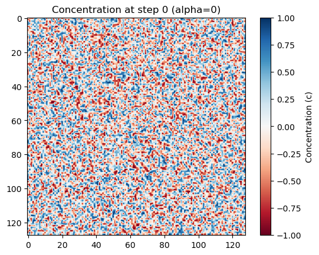
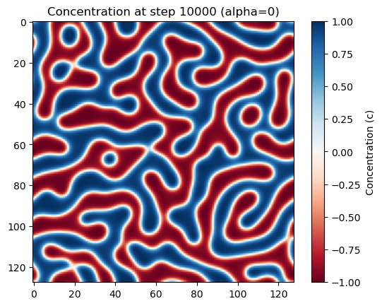
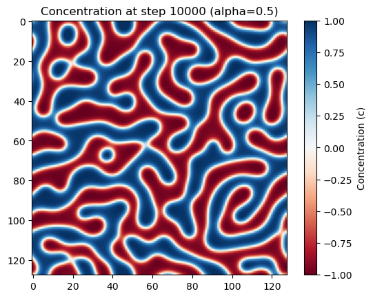
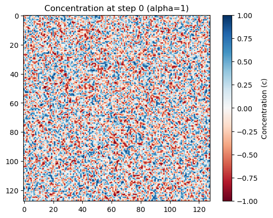
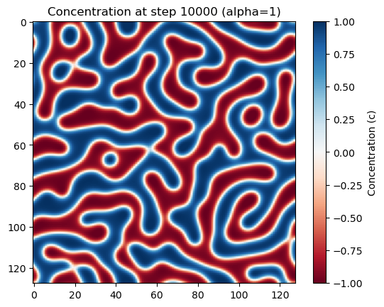

Group report 

# Cahn-Hilliard model

Describe the task in your own words, and/or link to the task description. 
(Test gaggi meier)

## Layout of the algorithm, functions to be created

Name the most important functions and mention their functionality, i.e., input and output.

      def myroutine(var1,var2):
          # does the following ...
          return ...

## How to run the code

Mention, how to run the code. Mention the parameters, in case your code has command line arguments. 

      python3 mycode.py
      python3 mycode,py arg1 arg2 

where arg1 and arg2 are ...

## Resulting files

Mention any resulting files and their format and meaning. 

## Successful tests

Summarize, which tests have been successfully passed to test your code. 

## Problems

The first problem we ran into, was that our code was very slow going through all 10000 time steps in *Task1\calculateConc.py*. We identified the main source of slowing the code down was the *laplacian()* function. Since for each step it checks all neighbours in a easy, but sadly rather time-consuming way. So the *laplacian()* function was rewritten with the np.roll(a, shift, axis). Here, a is the input array, shift is the amount by which the element is shifted, and axis is the axis along which the element should be shifted. This helped reduce the time it took to calculate the concentration changes by a huge amount.

In task 2.........

When writing the code for task 3, our first challenge was actually understanding how to implement what is asked of us. For this, we first tried to understand every aspect of the theory behind the task, i.e. understanding how we can go from the fourier transformed concentration field to the *k~MAX~*. This took quite a while to figure out, but eventually we did. Then it was much easier to also implement the task into python code. The next problem we had was that it took too long to compute the charcteristic lengthscale for t>100. Here we managed to cut down the time slightly by removing unnecessary calls of certain functions that we overlooked. A third problem was finding the values for *A* and *alpha*. This was becasue our *L(t)*  function just consited mostly of plateaus, making it hard to fit a linear plot to them.

## Results (speed tests etc.)

The beautiful part, where you report results, tables, files, or figures, after your code was able to run. 

### Task 4:

#### Asymmetric double well

We used the free-energy density

$$f(c)=\frac{(c^2-1)^2}{4}+\alpha c,$$

whose derivative is $f'(c)=c^3-c+\alpha$. The simulations use $N=128$, $M=1$,
$\kappa=1$, $\Delta t=0.01$, and the same reproducible random initial field
uniformly distributed between $-1$ and $1$ for each parameter value. We
compared $\alpha=0$, $\alpha=0.5$, and $\alpha=1$ through 10,000 time steps.

##### $\alpha=0$:

##### $\alpha=0.5$:

##### $\alpha=1$:

The concentration patterns are identical for these parameter values. In the
conserved Cahn–Hilliard equation, $\alpha$ contributes the spatially constant
term $\alpha$ to the chemical potential. The evolution takes the Laplacian of
the chemical potential, and the Laplacian of a constant is zero. This means the linear tilt does not change the concentration evolution for a fixed
initial field and conserved mean concentration.
