Group report 

# Cahn-Hilliard model

Describe the task in your own words, and/or link to the task description. 

The Cahn-Hilliard model is a model, which describes the process of phase separation in binary mixtures.
Its main idea is that a material will not separate instantly, but small composition fluctuations will grow that produce domains which grow larger. This idea is important in material science as it can influence microstructure, mechanical properties as well as phase stability.

All in all this model was divided into four tasks with the first one simulating phase separation and then in the second checking if the simulation obeys mass conservation and free energy disipation.
In the third task the domain growth was measured by quantifying how the characteristic size of the separated domoains increase over time. Lastly in the fourth task five different energy models were investigated to see how free energy functions influence phase separation and its resulting structure.

## Layout of the algorithm, functions to be created

Name the most important functions and mention their functionality, i.e., input and output.

In the first task as well in the tasks that follow one of the most important function was the "advance" function. As this was always used to calculate the concentration field in tasks 1 and 4. It calculates the chemical potential by the given formula and  given concentration and returns the concentration + delta t times mobility and times the laplacian of the chemical potential.

def advance(concentration):
    """Calculate the concentration field one time step later."""
    chemical_potential = (
        concentration**3 - concentration
        - kappa * laplacian(concentration)
    )
    return concentration + deltat * mobility * laplacian(chemical_potential)

## How to run the code

Mention, how to run the code. Mention the parameters, in case your code has command line arguments. 

      python3 mycode.py
      python3 mycode,py arg1 arg2 
where arg1 and arg2 are ...

## Resulting files

Mention any resulting files and their format and meaning. 

## Successful tests

Summarize, which tests have been successfully passed to test your code. 

## Problems

The first problem we ran into, was that our code was very slow going through all 10000 time steps in *Task1\calculateConc.py*. We identified the main source of slowing the code down was the *laplacian()* function. Since for each step it checks all neighbours in a easy, but sadly rather time-consuming way. So the *laplacian()* function was rewritten with the np.roll(a, shift, axis). Here, a is the input array, shift is the amount by which the element is shifted, and axis is the axis along which the element should be shifted. This helped reduce the time it took to calculate the concentration changes by a huge amount.

In task 2.........

When writing the code for task 3, our first challenge was actually understanding how to implement what is asked of us. For this, we first tried to understand every aspect of the theory behind the task, i.e. understanding how we can go from the fourier transformed concentration field to the *k~MAX~*. This took quite a while to figure out, but eventually we did. Then it was much easier to also implement the task into python code. The next problem we had was that it took too long to compute the charcteristic lengthscale for t>100. Here we managed to cut down the time slightly by removing unnecessary calls of certain functions that we overlooked. A third problem was finding the values for *A* and *alpha*. This was becasue our *L(t)*  function just consited mostly of plateaus, making it hard to fit a linear plot to them.

For task four the different subtasks were divided in the group, where first a general code was created for the Asymmetric double well, which was then used for the other codes and slightly altered. Most of the subtasks went smoothly and there was no bigger problem except with the triple well potential. Here one of the main problems that arose were the results themselves. The graph that was created after 10000 steps always turned out to be completely white and never either red or blue, which suggested that some of the code might be faulty. After checking the math and the code with the professor it was tested if a different concentration distribution would change the graphs colors. This turned out to be true as changing the parameter to smaller distributions resulted in the graph after 10000 steps being mostly red or blue depending on the concentration region.

## Results (speed tests etc.)

### Task 1:

Following the steps in the task and using the double-well free energy function

$$f(c)=(c^2-1)^2/4$$

We simulated the change of the concentration profile, here at timestep 0, 2500, 5000, 7500 and 10000:

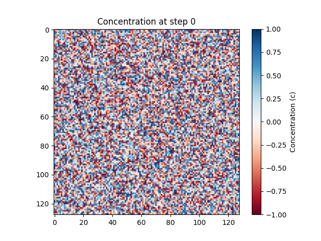
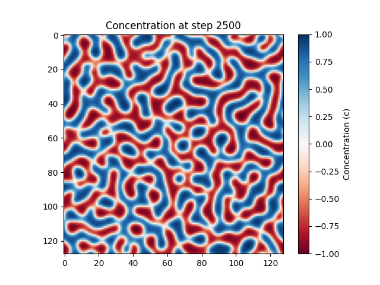
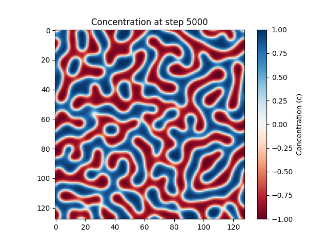
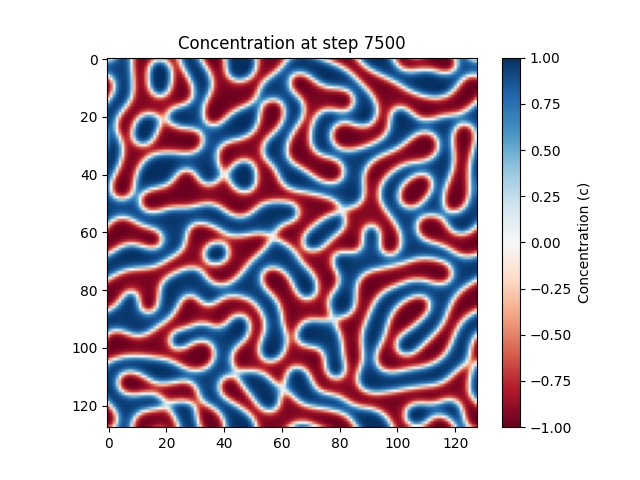
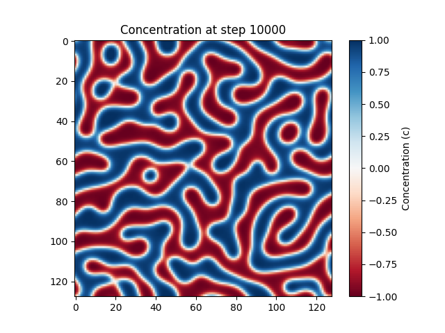

### Task 2:

### Task 3:

### Task 4:

#### Asymmetric double well

We used the free-energy density

$f(c)=\frac{(c^2-1)^2}{4}+\alpha*c^3 c,$$

whose derivative is $f'(c)=c^3-c+3*\alpha*c^2$. The simulations use $N=128$, $M=1$,
$\kappa=1$, $\Delta t=0.01$, and the same reproducible random initial field
uniformly distributed between $-3.5$ and $1$ for each parameter value. We
compared $\alpha=0$, $\alpha=0.1$, $\alpha=0.25$, $\alpha=0.5$, and $\alpha=1$ through 10,000 time steps.

##### $\alpha=0$:

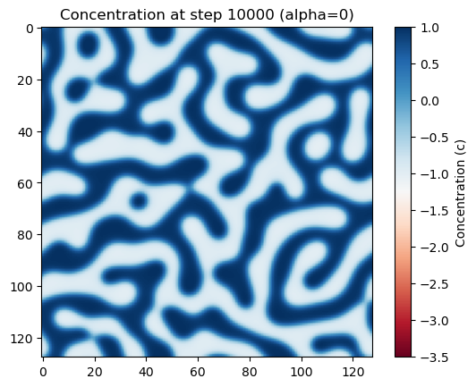

##### $\alpha=0.1$:

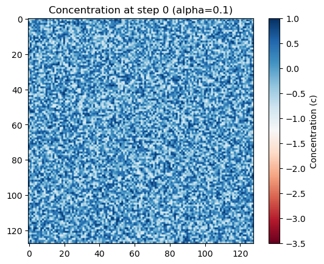
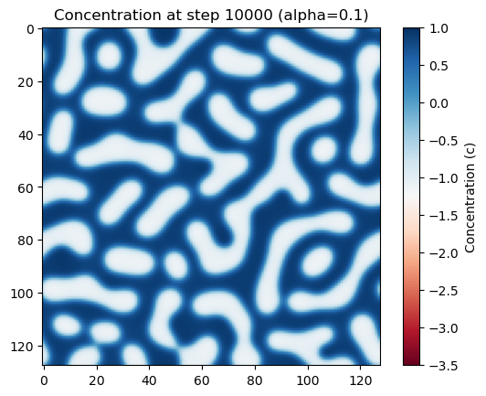

##### $\alpha=0.25$:

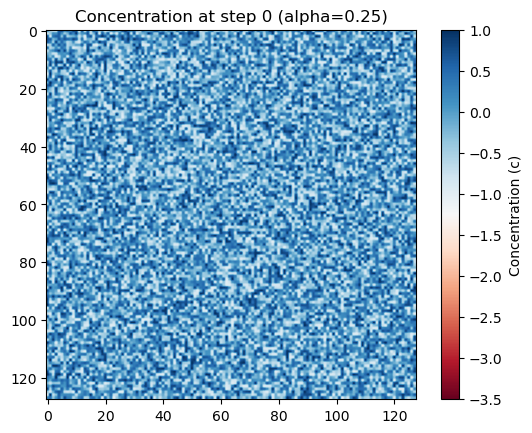
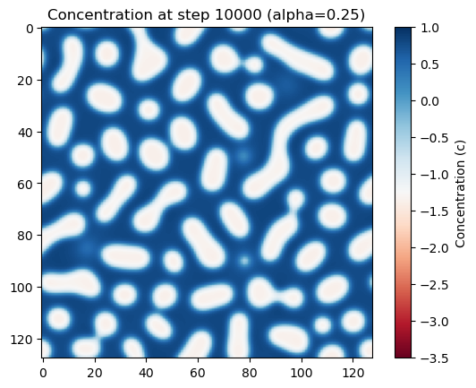

##### $\alpha=0.5$:

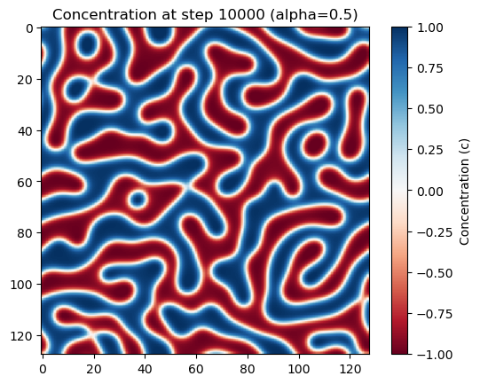

##### $\alpha=1$:

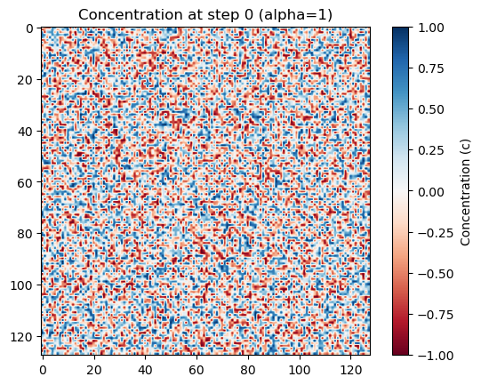
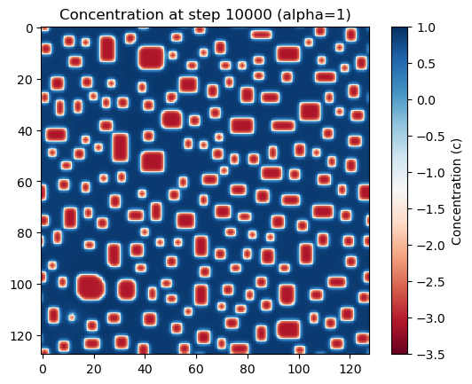

When comparing the concentration patterns for different $\alpha$ with the functions as seen in the following figure, one can see that the concentration splits into two wells, that are given by the minima of the functions.

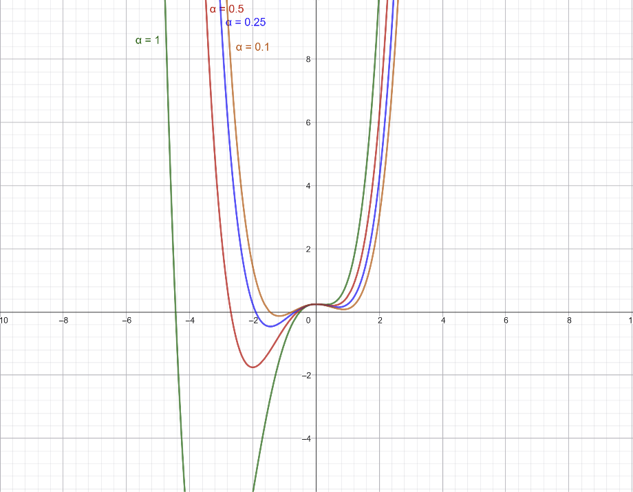

The only result where we arent too sure what is happening is the one for $\alpha=1$. Since in the concentration snapshot after 10000 timesteps it looks like that a lot of the concentration is at $c=1$, which wouldnt be correct, since the function has non minima there.

#### Flory Huggins free energy for polymers

For this task we used the function: 

$$f(c) = c \ln(c) + (1-c)\ln(1-c) + \chi c(1-c)$$

which has $\chi=2.5$ as a parameter. The derivative of this function turned out to be: $f'(c)=\log(c) - \log(1 - c) + \chi*(1 - 2*c)$. The simulations were done with 0 and 10000 steps. The random concentration distribution to initiate the simulation was set between $0.45$ to $0.55$. This is due to the fact that we didn't want the concentration value to leave the range of $0$ to $1$, otherwise the logarithms would be undefined. The resulting initial and final concentration was:

This fits, as the function has a double well structure with minima at a relative concentration of around $0.14$ and $0.86$

#### Triple well potential

For this task we used the function: 

$$f(c)=(c+1)^2 c^2(c-1)^2$$

which does not have a parameter. The derivative of this function turned out to be: $f'(c)=6c^5 - 8c^3 + 2c $. The simulations were done with 0 and 10000 steps. In total three simulations were done. The first one keeping the random concentration distribution in the range of $-1.5$ to $1.5$ as used in other examples. The second simulation uses a distribution between $-0.55$ to $-0.45$ and the last simulation was between $0.45$ to $0.55$.

##### Distribution between -1.5 to 1.5:

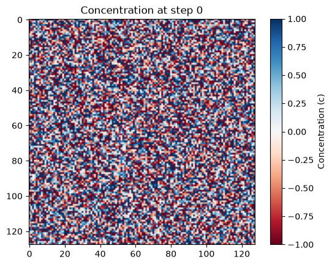
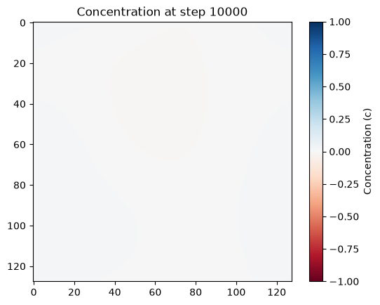

##### Distribution between -0.55 to -0.45:

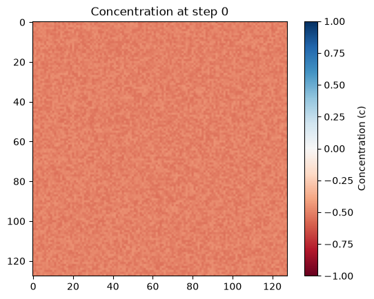
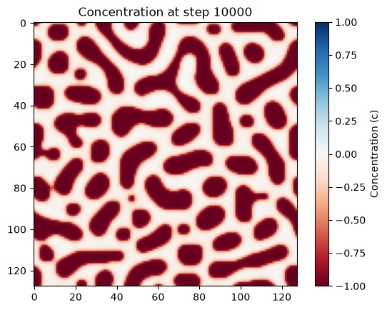

##### Distribution between 0.45 to 0.55:

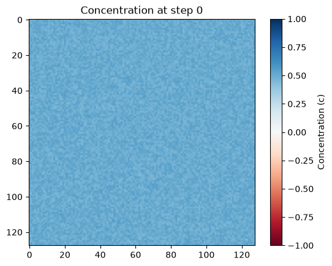
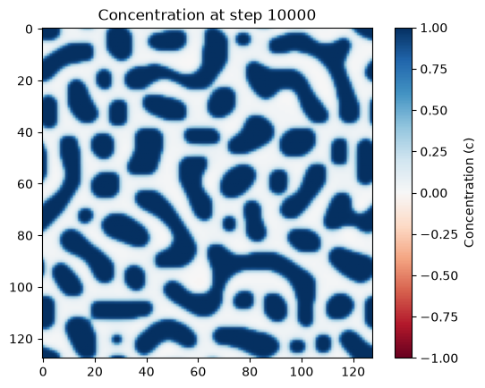

It is visible that for the smaller concentrations in either the positive or negative regime it concentrates into either only red and white or only blue and white. This makes it evident that there should be three wells within the system but also with the example of the distribution from -1.5 to 1.5 we see that the well of the white distribution has to be the global minimum as it always turns white with a bigger distribution.

#### Non-convex + external field

#### Periodic free energy (mathematically interesting)

